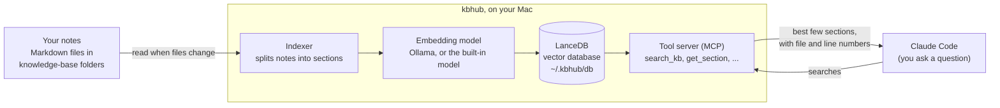

# kbhub : Knowledge Base Hub

**kbhub gives Claude Code a memory for your projects.** You keep notes about a project as plain
text files: what was decided and why, research, how-to guides, where the work was left. kbhub keeps
one search index of all those notes on your Mac, and Claude looks things up there by itself before
it starts working.

## The problem it solves

Every new AI session starts from zero. It does not know what you decided last month, what you
already tried, or where the last session stopped. So you explain it again, or it re-reads piles of
files, or (worst) it confidently follows a decision you reversed weeks ago.

The usual fix is a folder of notes. That helps, but then:

- the notes are scattered across projects and nobody knows which file holds the answer;
- reading everything "just in case" is slow and expensive;
- old and current notes look the same, so outdated ones get acted on;
- handing work to another person, or to tomorrow's session, loses half the context.

## What you get

- **Claude finds the right note by itself.** Ask "why do we round invoices this way?" and it
  searches the index and reads only the section that answers it.
- **Notes live where they belong.** Inside a code project (`<project>/knowledge-base/<topic>/`,
  saved together with the code) or in a standalone folder for research and planning.
- **One place to search, wherever the notes are.** Every knowledge base on your Mac is in the same
  index, across all projects.
- **Outdated notes are marked, not deleted.** Mark a note "superseded" and it stops showing up
  unless you ask for history.
- **Smooth handovers.** Each knowledge base has a short "current state" page and handover notes,
  so the next session, or the next person, picks up where the last one stopped.
- **Work and personal stay apart.** A search from a work project does not return personal notes,
  and the other way round.
- **Private.** The index and the search run on your Mac. Nothing is uploaded.

A "knowledge base" here is nothing special: a folder of Markdown (`.md`) text files you can open
in any editor.

## Install

You need:

- a Mac with Apple silicon (M1 or newer);
- access to this repository (it is private: ask whoever shared it to add your GitHub account);
- [Claude Code](https://claude.com/claude-code). If it is missing, setup offers to install it.

Open the Terminal app and run these two lines:

```
git clone https://github.com/shiva2021/kbhub ~/.kbhub
~/.kbhub/setup
```

That is the whole installation. Setup takes about five minutes, most of it downloading. It
installs what is missing and asks before each install; press Enter to accept a suggestion.
Pressing Ctrl-C or Ctrl-D stops it; run it again and it carries on.

What setup asks:

| Question | What it means | If you just press Enter |
| --- | --- | --- |
| Install uv? | A small tool that runs kbhub and brings its own Python. Required. | Installed |
| Install Claude Code? | Only asked if it is missing. | Installed |
| Install Ollama? | A free app that lets search understand meaning, not only matching words. About 1.5 GB. Say no to use a smaller built-in model: nothing to install, weaker search. | Installed |
| Where do your projects live? | The folder that holds your code or research projects. | The folder it suggests |
| Folder of personal projects? | Optional. Notes under it are kept apart from work notes. | None |
| Where should your knowledge bases go? | The folder your notes are kept in, outside your projects. | `~/knowledge-bases` |
| Add `<folder>` to the index? | Asked for each folder of notes it finds in your projects. | Added |

What setup changes on your Mac:

- `~/.kbhub`: the program, your settings (`config.toml`) and the search index;
- `~/.kbhub-config`: your answer, per project, to "keep a knowledge base for this project?";
- Claude Code: adds the kbhub search tools, a skill, a short rule in `~/.claude/CLAUDE.md`, and a
  start-up note that tells each session which knowledge bases exist and whether to ask you about
  one;
- `~/.local/bin/kbhub`: the `kbhub` command, plus (if you agree) one line in `~/.zshrc` so the
  Terminal finds it;
- the programs you said yes to: uv, Claude Code, Ollama.

Before it edits `settings.json` or `CLAUDE.md` it saves a copy next to the file
(`….kbhub-backup`).

It never changes, commits or uploads anything in your projects.

**If `git clone` asks you to install "command line developer tools"**, click Install, wait, and run
the line again. **If it says the repository was not found**, either your GitHub account has not
been given access yet, or the Terminal is not signed in to GitHub. Ask for access first; to sign in,
the simplest way is to install [GitHub Desktop](https://desktop.github.com) and sign in there once,
then run the line again.

## Your first knowledge base

Open Claude Code inside one of your projects (a git repository). The first time, before it starts
on your request, Claude asks:

> Should kbhub keep a knowledge base for this project?

- **Yes:** Claude looks for notes this project already has. If there are none, it creates a
  knowledge base called `<project>/general` in your knowledge-base folder (the one you chose at
  setup, `~/knowledge-bases` unless you changed it), with a few starter files (current state,
  decisions, lessons, open items), and adds it to the index. From then on, tell Claude what you
  decide and it writes it down; ask what was decided and it looks it up.
- **No:** Claude does not bring it up again in that project.

You are asked once per project. To change your answer, run `kbhub kb on` or `kbhub kb off` inside
the project (`kbhub kb status` shows the current answer).

The notes are kept **outside** your project, so nothing in the project changes. They are ordinary
text files. If you would rather keep a topic's notes inside the project and save them with the
code, say "create a knowledge base for billing inside this repo".

## Everyday use

You mostly just talk to Claude. Some things worth knowing:

| I want to… | Say to Claude | Or type in Terminal |
| --- | --- | --- |
| Find something | "what did we decide about refunds?" | `kbhub search "refund decision"` |
| Start notes for a new topic | "create a knowledge base for search" | `kbhub new-kb search` (inside the project) |
| Keep a topic's notes in the project | "create a knowledge base for search inside this repo" | `kbhub new-kb search --in-repo` |
| Stop or start notes for a project | "don't keep a knowledge base for this project" | `kbhub kb off` / `kbhub kb on` |
| Start notes not tied to code | "create a standalone knowledge base called market-research" | `kbhub new-project market-research` |
| Record a decision | "record that we chose Postgres, and why" | edit `decisions.md` |
| Pick up where I left off | "where are we up to?" | open the `STATE.md` file |
| Hand over | "write a handover for this session" | add a file under `handovers/` |
| Retire an old note | "mark the old pricing notes as superseded" | `kbhub rule add <name> "old/**" --status superseded` |
| Add notes that already exist | "scan for knowledge bases and register them" | `kbhub scan`, then `kbhub register <folder>` |
| See what is indexed | "list the knowledge bases" | `kbhub projects` |

New and edited notes are searchable straight away; there is no "save to index" step.

## Update, check, remove

| Command | What it does |
| --- | --- |
| `kbhub doctor` | Checks every part of the install and tells you how to fix what is wrong. |
| `kbhub update` | Gets the newest version and reconnects it. |
| `kbhub setup` | Runs setup again (safe at any time), for example to add Ollama later. |
| `kbhub uninstall` | Disconnects kbhub from Claude Code. Your notes are never touched; delete `~/.kbhub` afterwards to remove the program and index too. |

## Troubleshooting

Start with `kbhub doctor`: it names the problem and the fix. The common ones:

- **`kbhub: command not found`**: add `export PATH="$HOME/.local/bin:$PATH"` to `~/.zshrc`, then
  open a new Terminal window. Until then, `~/.local/bin/kbhub` works.
- **Claude does not seem to search**: start a new Claude Code session (tools load at start), then
  ask it to "check the knowledge base". `kbhub doctor` shows whether the tools are connected.
- **Search misses things it should find**: Ollama is probably not running. Open the Ollama app, or
  run `kbhub setup` to install it. Without it, search only matches words.
- **A note does not show up**: check the folder is indexed with `kbhub projects`; if not,
  `kbhub scan` and `kbhub register <folder>`.
- **Something is badly off**: `kbhub index --rebuild` rebuilds the index from your files. The index
  is only a copy; your notes are the source and are never changed by a rebuild.

## How it works



In words:

1. **Index.** kbhub reads your notes and splits them into sections, following the headings.
2. **Embed.** Each section is turned into an "embedding": a list of numbers that captures its
   meaning, made by Ollama or the built-in model.
3. **Store.** Text and embeddings go into LanceDB, a small vector database that is just a folder
   on your Mac (`~/.kbhub/db`). There is no database server to run.
4. **Search.** A search matches by meaning (embeddings) and by exact words (keywords) at the same
   time, merges the two lists, and returns the best few sections with their file and line numbers.
5. **Connect.** Claude Code reaches all this through a local tool server (MCP) that starts with
   each session. The index refreshes itself whenever your files change.

### What it is built with

| Part | What is used | Why |
| --- | --- | --- |
| Vector database | [LanceDB](https://lancedb.com) | Runs inside kbhub as a folder of files; does both meaning search and keyword search. |
| Embedding model | [Ollama](https://ollama.com) with `nomic-embed-text` | Runs on your Mac, free, good search quality. |
| Fallback model | [WordLlama](https://github.com/dleemiller/WordLlama) | Small and built in; used when Ollama is not installed or not running. |
| Search method | Hybrid search: vectors plus keywords, merged by reciprocal rank fusion | Finds notes by meaning and by exact names such as ticket numbers. |
| Link to Claude Code | [MCP](https://modelcontextprotocol.io) tool server, plus a skill, a session-start hook and a rule in `CLAUDE.md` | Claude searches by itself, in every session. |
| Language and tooling | Python 3.13, run by [uv](https://docs.astral.sh/uv/) | uv brings its own Python, so there is nothing else to install. |
| Your notes | Plain Markdown files | Open in any editor; the index is only a copy of them. |

Everything in this table runs on your Mac. Nothing is sent to a cloud service.

Knowledge bases inside code projects are listed in `~/.kbhub/registry.json`, so nothing extra is
ever written into your projects. Details, every command and every setting:
[docs/reference.md](docs/reference.md).

**Cowork:** Cowork cannot use the tool server. A separate read-only skill covers it: run
`kbhub cowork-skill`, upload the zip it writes to your claude.ai account, and give Cowork access
to `~/.kbhub`.

## For contributors

```
cd ~/.kbhub
uv sync --extra dev
uv run pytest -q
```

Code is in `kbhub/`, the session hook in `hooks/`, the skills in `skill/`, tests in `tests/`.
Tests never touch your real home folder or Claude Code settings.
